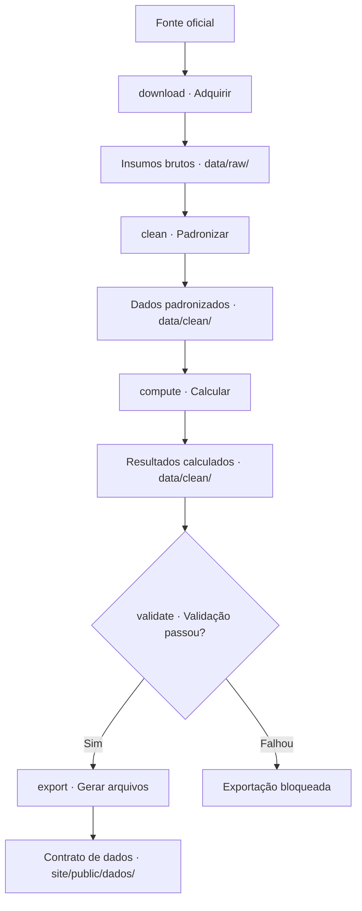

# Arquitetura da pipeline

Uma **Fonte** é o provedor oficial citado no site. Uma `source` é a unidade
de processamento registrada no pipeline. A Fonte Painel-Oncologia alimenta
a `source` `painel`.

Na raiz do repositório, execute a pipeline completa com
`uv run python -m pipeline run`. O comando executa todas as etapas de cada
`source` registrada. O [guia de desenvolvimento](development.md#trabalhar-no-pipeline)
mostra os pré-requisitos e como listar ou selecionar `source`s e etapas.

A entrada [`python -m pipeline`](../pipeline/__main__.py)
passa o [registro de `source`s](../pipeline/sources/__init__.py) ao
[CLI](../pipeline/cli.py), que executa as etapas do
[protocolo `Source`](../pipeline/source.py).

## Da Fonte ao Contrato de dados

Os formatos intermediários dependem da `source`. Nas etapas de cálculo e
validação, a unidade pode ler também a malha ou outros insumos do mesmo
snapshot. Se uma etapa falha, o CLI pula as etapas restantes daquela
`source`, segue com as demais selecionadas e retorna código de saída 1.
Para preparar uma atualização isolada dos dados vigentes, veja o
[guia do mantenedor](data-update.md).

O [Contrato de dados](spec.md#15-contrato-de-dados) é a fronteira entre
pipeline e site. O Astro usa os JSON commitados para exibir valores, classes
de Tendência, Situação, origem na cascata e faixas A/B/C já calculados.
O [guia de desenvolvimento](development.md) mostra como rodar o site com
esses arquivos.

## Indicador de 60 dias no Painel-Oncologia

[`PainelSource`](../pipeline/sources/painel/source.py) coordena o percurso.
Os caminhos abaixo são relativos à raiz do repositório.

| Etapa | Onde seguir o Indicador |
| --- | --- |
| `download` | A [aquisição](../pipeline/sources/painel/acquisition.py) baixa `POBR<ano>.dbc` do FTP do DATASUS, de 2014 em diante, e duas tabelas anuais do TabNet em HTML. Os arquivos ficam em `data/raw/painel/`. |
| `clean` | Os DBC são lidos e agregados. A [persistência](../pipeline/sources/painel/persistence.py) grava `cases.parquet` por ano, município de residência e tipo, `months.parquet` por mês e modalidade de primeiro tratamento e `extract.json` com a data da extração. A etapa também copia as tabelas do TabNet para `data/clean/painel/tabnet/`. |
| `compute` | A etapa lê os Parquet e a relação entre municípios e Regiões imediatas de [`municipalities.json`](../site/public/dados/municipalities.json). Passa os dados a [`calculate`](../pipeline/sources/painel/calculation.py) e grava `layers/<tipo>.json`, `layers/<tipo>-profiles.json` e `monthly_alerts.json` em `data/clean/painel/`. |
| `validate` | A [validação](../pipeline/sources/painel/validation.py) compara agregados do recorte Todos os cânceres por UF e ano com as duas tabelas do TabNet. Também verifica cobertura da malha, percentuais plausíveis e presença de faixa nas UFs. Quedas mensais por modalidade geram alertas informativos. |
| `export` | A [montagem dos documentos](../pipeline/sources/painel/export.py) usa os resultados calculados para gerar as camadas do mapa e incorporar o Indicador aos perfis por UF. `PainelSource.export` repete as verificações que bloqueiam a exportação, inclusive quando acionada isoladamente, e atualiza o manifesto. |

**Valor, Situação e Tendência** usam casos cujo primeiro tratamento foi
quimioterapia, radioterapia ou ambos (`TRATAMENTO` 2, 3 ou 4). O valor é a
proporção desses casos com tratamento em até 60 dias. A tabela do TabNet
filtrada por modalidade confere a contagem e essa proporção.

**Percentual sem informação e faixa A/B/C** usam todos os casos
diagnosticados. A faixa resume a qualidade do registro por UF e tipo nos
últimos cinco anos consolidados. A tabela do TabNet de todos os casos
confere a contagem, o percentual em até 60 dias nesse universo e o
percentual sem informação. Veja os filtros, as tolerâncias e a evidência
da [comparação com o TabNet](data-sources.md#painel), além da
[decisão sobre os recortes](adr/0003-within-60-days-on-chemo-and-radio-cases.md).

Os três destinos em `site/public/dados/` podem ser conferidos no repositório.

- [`map/within_60_days/all.json`](../site/public/dados/map/within_60_days/all.json)
  é a camada do mapa para Todos os cânceres. Em `municipalities`, cada código
  aponta para o valor e as classes usados no mapa.
- [`profiles/PE.json`](../site/public/dados/profiles/PE.json)
  é o perfil de Pernambuco. Em `indicators.within_60_days.all` ficam os
  municípios e as séries usadas nas fichas, com a mesma origem do mapa.
- [`manifest.json`](../site/public/dados/manifest.json)
  registra a extração em `sources.painel`, os períodos em
  `indicators.within_60_days` e a versão do pipeline em `pipeline_version`.

Para seguir Recife nos arquivos, procure o código `261160` em
`municipalities` no mapa e no perfil de Pernambuco. No perfil, o
`series_id` leva ao histórico em `series`. O campo `period` coincide
nos dois arquivos e em `indicators.within_60_days.all` no manifesto.
