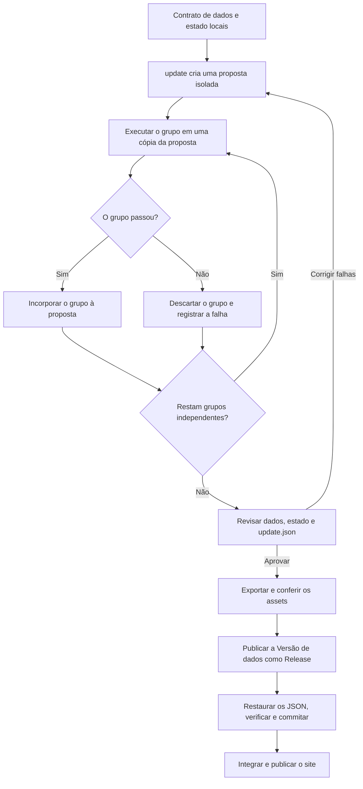

# Atualizar e publicar os dados

Execute os comandos na raiz do repositório. A atualização é manual. Consulte o calendário, os insumos e os limiares de cada `source` em [Fontes de dados](data-sources.md). Uma nova extração segue os períodos configurados no código. Revise o pipeline antes de acrescentar um ano de mamografia, POPSVS ou uma edição INCA e preserve o encerramento da série de citopatológico em 2025.



## Preparar uma atualização

Instale Python 3.14+, `uv` e rode `uv sync --locked`. Use a árvore limpa (`git status --porcelain`), o Contrato de dados em `site/public/dados/` e o estado correspondente em `data/clean/`. Reserve disco para os insumos e as cópias por grupo. Para retomar em outra máquina, use `restore-release` e `restore-state` do [nível 2 do guia do pesquisador](reproducibility.md#nível-2--recalcular-com-o-estado). Restaure em destinos novos fora da árvore e ajuste `DATA_DIR` e `CLEAN_DIR` no exemplo.

- **HPV** exige Chromium para a coleta oficial (`uv run playwright install chromium` ou `CHROMIUM_PATH`). A consulta cobre de 2020 até o ano corrente.
- **Vigitel** exige obter o arquivo com `./download-vigitel.sh` ou indicá-lo com `VIGITEL_INPUT_PATH`.
- **INCA** usa a edição transcrita e versionada. Revise a referência e o pipeline para trocar de edição.
- **`mesh` e `cnes`** usam mapshaper. Instale Node e rode `npm ci --prefix pipeline`.

```bash
WORK=$(mktemp -d)
DATA_DIR=site/public/dados
CLEAN_DIR=data/clean
uv run python -m pipeline update --source painel --source cnes --source hpv \
  --data-dir "$DATA_DIR" --clean-dir "$CLEAN_DIR" --output "$WORK/proposal"
```

`update` passa por `download`, `clean`, `compute`, `validate` e `export`. A proposta contém `dados/`, `clean/` e `update.json`. O contrato e o estado de entrada permanecem intactos.

Repita `--source` para selecionar mais de uma. `popsvs` agrupa `siscan`, `siscan_cytopathology` e `sim` por dependerem da mesma população. Escolher só `sim` usa a população do snapshot. `mesh` inclui todas as `source`s no mesmo grupo. Uma falha descarta toda a cópia do grupo, mantém seus dados e estado anteriores e deixa os grupos independentes seguirem. O comando retorna código 1 se algum grupo falhar. Veja a [verificação de isolamento e continuidade](data/pipeline-reorganization-verification.md).

## Revisar a proposta

1. Confira `attempted_at`, `selected`, `successful` e `failures` em `"$WORK/proposal/update.json"`. Se houver falha, preserve o log, corrija a causa e prepare outra proposta em um destino novo. O cache de download pode ser reaproveitado.
2. Rode `git diff --no-index "$DATA_DIR" "$WORK/proposal/dados"`. Código 1 nesse comando indica diferenças. No `manifest.json`, confira o commit em `pipeline_version` sem `-dirty`, a proveniência e os períodos por Indicador e Tipo de câncer.
3. Confira mapas e perfis, com atenção a períodos provisórios, valores ausentes, alertas e mudanças em séries, Tendência, Situação, cascata e faixa A/B/C. Investigue divergências com as [referências e os limiares por Fonte](data-sources.md).

## Publicar a Release e incorporar os JSON

Use `dados/` e `clean/` da mesma proposta. Gere os assets em um destino novo e confira o conteúdo. Cada asset deve ter menos de 2 GiB. Mantenha `data/raw/`, extratos de pacientes e a auditoria HPV fora da Release. O empacotador limita o estado HPV a `official.json` e `census.parquet` e copia os diretórios das demais `source`s. Confira e autorize o estado Vigitel a cada publicação, pois contém entrevistas sem identificadores diretos. As limitações do estado por Versão de dados estão no [guia do pesquisador](reproducibility.md#nível-2--recalcular-com-o-estado).

```bash
uv run python -m pipeline export-release --data-dir "$WORK/proposal/dados" \
  --state-dir "$WORK/proposal/clean" --output "$WORK/assets"
```

Para publicar, use o GitHub CLI autenticado (`gh auth login`), com permissão no repositório, e substitua `data-AAAA-MM-DD` por uma versão inédita. `release` reexporta os assets e chama `gh release create`. Para outro repositório, use `--repository owner/repo`.

```bash
uv run python -m pipeline release data-AAAA-MM-DD --data-dir "$WORK/proposal/dados" \
  --state-dir "$WORK/proposal/clean" --output "$WORK/assets"
```

Se a publicação falhar, confira `gh release view data-AAAA-MM-DD` e os assets antes de tentar de novo. A tag publicada é imutável e a CLI não faz rollback.

A Release disponibiliza os dados abertos. O site passa a usar a nova versão após incorporar os JSON e fazer o deploy. Para a incorporação, abra uma branch de trabalho a partir de `hml`, use Node 24 (mínimo do site: 22.23.4) e `npm ci --prefix site`:

```bash
uv run python -m pipeline restore-release --assets "$WORK/assets" --output site/public/dados
npm run check --prefix site
npm run build --prefix site
git diff -- site/public/dados
```

Se as verificações passarem e o diff corresponder à proposta, faça o commit na branch de trabalho:

```bash
git add site/public/dados
git commit -m "data: publish data-AAAA-MM-DD"
```

Envie a branch e abra o PR para `hml`. A publicação do site segue a promoção de `hml` para `main`, descrita no [guia de contribuição](development.md#contribuir). Registre o commit gerador do manifesto e o commit de incorporação. A [prova da Versão de dados rastreável](data/traceable-version.md) registra os checksums, a restauração e o recálculo da Release `data-2026-11-06`.

## Auditoria HPV opcional

A auditoria com microdados é local e separada da atualização oficial. Use `hpv-audit --step download` e `hpv-audit --step clean` com `--year` para preparar cada ano. `hpv-audit --step compute` exige o histórico completo e é executado sem `--year`. Veja os [comandos e insumos da auditoria](data/hpv-official-inputs.md).
