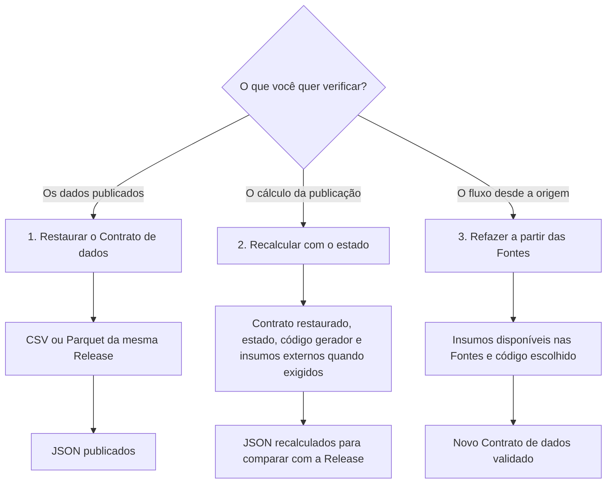

# Guia do pesquisador

Para analisar os dados, baixe os CSV ou Parquet da [Versão de dados](https://github.com/kvojps/brazil-cancer-map/releases) que pretende citar. Cada tabela preserva uma parte do Contrato de dados. A coluna `file` identifica o JSON, `path` indica onde inserir o registro e `value` guarda o valor codificado em JSON. Os metadados de Fonte e período aparecem na primeira linha de cada combinação. Consulte as [fórmulas, ressalvas e orientações de citação](https://brazil-cancer-map.kvojps.workers.dev/metodologia/).



## Nível 1 — Restaurar os JSON

Use um clone do repositório, GitHub CLI (`gh`), Python 3.14+ e `uv`. Na raiz, baixando a Release `data-2026-11-06` como exemplo:

```bash
uv sync --locked
WORK=$(mktemp -d)
gh release download data-2026-11-06 --repo kvojps/brazil-cancer-map --dir "$WORK/assets"
uv run --locked python -m pipeline restore-release --assets "$WORK/assets" --output "$WORK/reference"
```

Parquet é o padrão. Para restaurar a partir dos CSV, acrescente `--format csv` e escolha outro destino. Compare com os JSON de um checkout que já incorpore a **mesma** Versão de dados. O commit gerador antecede o commit de incorporação. A igualdade esperada é de conteúdo JSON, incluindo os tipos, independentemente da formatação e da ordem das chaves.

Para comparar, rode o trecho abaixo. No nível 2, use o mesmo trecho após o recálculo.

```bash
uv run --locked python - site/public/dados "$WORK/reference" <<'COMPARE'
import json
import sys
from pathlib import Path

def read_contract(directory):
    root = Path(directory)
    return {
        path.relative_to(root): json.dumps(json.loads(path.read_text(encoding="utf-8")), sort_keys=True)
        for path in root.rglob("*")
        if path.suffix in {".json", ".topojson"}
    }

actual, expected = map(read_contract, sys.argv[1:])
differences = sorted(path for path in actual.keys() | expected.keys()
                     if actual.get(path) != expected.get(path))
print(f"{len(expected)} arquivos de referência, {len(differences)} diferenças")
for path in differences:
    print(path)
sys.exit(bool(differences))
COMPARE
```

A [prova com os assets públicos](data/traceable-version.md) conferiu os 48 arquivos de `data-2026-11-06` nos dois formatos e registra os checksums.

## Nível 2 — Recalcular com o estado

Consulte `pipeline_version` no `manifest.json` restaurado para localizar o commit gerador. O manifesto também identifica a proveniência em `sources` e os períodos por Indicador e Tipo de câncer em `indicators`. `mesh` e `popsvs` são auxiliares e não têm entrada própria em `sources`.

| Versão de dados | Limites no commit gerador |
|---|---|
| `data-2026-11-05` | Permite restaurar os JSON. Foi gerada com `0.1.0+df740cd-dirty` e veio sem assets de estado. |
| `data-2026-11-06` | Traz nove assets de estado e identifica `0.1.0+a98b5fd`. Para recalcular `mesh`, forneça a lista IBGE da época em `data/raw/mesh/ibge_municipalities.json`. Para `painel`, forneça as 26 páginas TabNet usadas na publicação em `data/raw/painel/tabnet/` (todos os casos e quimio e radio para cada um dos 13 anos). Os assets públicos não incluem esses insumos. O HPV exige todos os anos até o ano corrente nesse commit. O estado vai até 2026, portanto é insuficiente para esse cálculo a partir de 2027. |

Para uma Release com estado, use os pré-requisitos do nível 1, um clone separado e o commit gerador. O destino `data/clean` precisa estar ausente. O exemplo usa o commit gerador de `data-2026-11-06`. Para incluir `cnes`, use Node 24 e instale o mapshaper com `npm ci --prefix pipeline`. Reutilize `$WORK/assets` e `$WORK/reference` do nível 1 ou baixe os assets e restaure novamente a referência antes de prosseguir.

```bash
git switch --detach a98b5fd8d4d43602d26ac020426928b7531b4952
uv sync --locked
npm ci --prefix pipeline
uv run --locked python -m pipeline restore-release --assets "$WORK/assets" --output site/public/dados
uv run --locked python -m pipeline restore-state --assets "$WORK/assets" --output data/clean
```

Com os insumos acima e ainda em 2026 no caso do HPV, o laço recalcula todas as `source`s. Para verificar um subconjunto, inclua somente as que você quer conferir e cujos insumos estão disponíveis. O INCA usa a referência versionada no código.

```bash
for source in mesh popsvs painel cnes siscan siscan_cytopathology sim hpv inca vigitel; do
  for step in compute validate export; do
    uv run --locked python -m pipeline run --source "$source" --step "$step" || exit 1
  done
done
```

Compare `site/public/dados/` com `"$WORK/reference"` por conteúdo JSON. A [prova da Versão de dados rastreável](data/traceable-version.md) registra a igualdade dos 48 arquivos após o recálculo de `data-2026-11-06` com os insumos externos fornecidos localmente. A falha temporal do HPV foi observada com [relógio simulado](https://github.com/kvojps/brazil-cancer-map/blob/04c2e4921f8b21f449b9f30601e900b9a12352a2/docs/data/hpv-temporal-recalculation.md).

### Recálculo com o código atual

As correções abaixo valem para o código e os insumos indicados. Para uma reprodução fiel de uma Release, siga os limites de seu commit gerador.

| `source` | Pré-requisitos para recalcular com o código atual |
|---|---|
| `mesh` | Estado preparado pelo `mesh.clean` corrigido, com `data/clean/mesh/ibge_municipalities.json`, atributos e TopoJSON. O recálculo dispensa rede e mapshaper. Para usar estado antigo com código atual, forneça a lista oficial daquela publicação no caminho limpo. [Prova com fixture](https://github.com/kvojps/brazil-cancer-map/blob/04c2e4921f8b21f449b9f30601e900b9a12352a2/docs/data/mesh-state-recalculation.md). |
| `painel` | Estado preparado pelo `painel.clean` corrigido, com `data/clean/painel/tabnet/ANO.html` e `chemo_radio/ANO.html` por ano observado, e índice municipal correspondente. O recálculo dispensa rede e DBC. Para usar estado antigo com código atual, forneça as páginas daquela publicação no caminho limpo. [Prova com fixture](https://github.com/kvojps/brazil-cancer-map/blob/04c2e4921f8b21f449b9f30601e900b9a12352a2/docs/data/painel-state-recalculation.md). |
| `hpv` | Estado com `official.json` (série contínua em `years` e data `extracted_at` válida) e `census.parquet`, índice municipal e referências oficiais. O recálculo usa o período registrado na extração e dispensa rede e Chromium. [Prova com relógios simulados](https://github.com/kvojps/brazil-cancer-map/blob/04c2e4921f8b21f449b9f30601e900b9a12352a2/docs/data/hpv-temporal-recalculation.md). |

Reempacotar um estado antigo mantém os arquivos que ele já tem. Para malha e Painel, use as referências da extração original, pois as Fontes podem mudar. Para comparar mudanças no código com insumos congelados, consulte a [caracterização da pipeline](https://github.com/kvojps/brazil-cancer-map/blob/04c2e4921f8b21f449b9f30601e900b9a12352a2/docs/data/pipeline-characterization.md) e a [verificação conjunta da reorganização](https://github.com/kvojps/brazil-cancer-map/blob/04c2e4921f8b21f449b9f30601e900b9a12352a2/docs/data/pipeline-reorganization-verification.md).

## Nível 3 — Refazer a partir das Fontes

Em um clone separado, prepare Python 3.14+, `uv`, Node 24, espaço para os insumos e os pré-requisitos de [cada Fonte](data-sources.md). Instale Chromium (`uv run playwright install chromium` ou `CHROMIUM_PATH`) para baixar os agregados oficiais do HPV, obtenha o arquivo local do Vigitel com `./download-vigitel.sh` ou `VIGITEL_INPUT_PATH` e confira a edição transcrita do INCA.

```bash
uv sync --locked
npm ci --prefix pipeline
uv run python -m pipeline run
```

O comando baixa, limpa, calcula, valida e exporta nos caminhos locais padrão. Confira o código de saída e as validações das Fontes. As séries podem ser regravadas pelos provedores, portanto o resultado pode divergir de uma Release anterior. Para preparar uma publicação em snapshot isolado, siga o [guia do mantenedor](data-update.md).

## Citar e reportar erros

Cite o Observatório do Câncer no Brasil, a Versão de dados, a URL da Release e a data de acesso. Cite também as Fontes originais conforme os [modelos e condições de reutilização](https://brazil-cancer-map.kvojps.workers.dev/metodologia/#reutilizacao-e-citacao). Ao [reportar um erro](https://github.com/kvojps/brazil-cancer-map/issues), inclua versão, arquivo, recorte, período, valor observado e referência esperada. Se houve reprodução, inclua o comando e a mensagem de erro.
